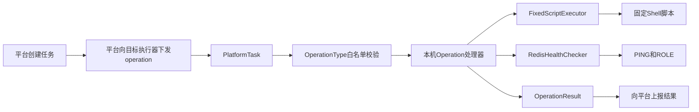

# Redis Monitor Agent 运维任务技术设计

## 1. 文档目的

本文档说明 `redis-monitor-agent` 执行器当前的部署结构、代码分层、运维任务模型、安全边界和后续开发顺序。

本文档只描述执行器及其本机 Redis 运维能力。中心管理平台、GaussDB 表结构和前端任务页面将在对应阶段单独设计。

## 2. 当前运行环境

| 项目 | 当前值 |
|---|---|
| 开发系统 | Windows |
| 执行器运行系统 | Ubuntu 虚拟机 |
| 虚拟机网络 | VMware 桥接模式 |
| Windows IP | `172.20.10.2` |
| 虚拟机 IP | `172.20.10.12` |
| Java | OpenJDK 8 |
| Spring Boot | 2.4.2 |
| Jedis | 3.6.3 |
| Redis | 6.2.17 |
| Redis端口 | `6379` |
| 执行器端口 | `9101` |

执行器和 Redis 部署在同一台虚拟机中。执行器通过 `127.0.0.1:6379` 访问本机 Redis。

## 3. 部署目录

```text
/opt/redis/releases/                         Redis版本目录
/opt/redis/current                           Redis当前版本软链接
/opt/redis/data/                             Redis数据目录
/etc/redis/redis.conf                        Redis配置
/etc/redis/sentinel.conf                     Sentinel配置
/opt/redis-monitor-agent/                    执行器目录
/opt/redis-monitor-agent/redis-monitor-agent.jar
/opt/redis-monitor-agent/scripts/            固定Shell脚本
/opt/redis-monitor-agent/state/              版本回滚等本机状态
/etc/redis-monitor-agent/agent.env            执行器环境变量
```

systemd 服务：

```text
redis-server.service
redis-sentinel.service
redis-monitor-agent.service
```

执行器服务只依赖网络就绪，不依赖 Redis 或 Sentinel 服务。Agent 开机后可以保持在线，再由平台决定何时启动或停止本机 Redis 与 Sentinel。

项目中的部署文件分工如下：

```text
deploy-to-vm.ps1                         Windows部署入口：构建、上传、调用安装器
deploy/install-agent.sh                  Linux安装器：目录、环境文件、JAR、脚本与回滚
deploy/redis-monitor-agent.service       Agent正式systemd单元
scripts/*.sh                             Redis与Sentinel固定运维脚本
docs/agent.env.example                   生产环境变量模板
```

部署脚本重复执行时会保留现有令牌和未被命令参数覆盖的环境配置，只重启 Agent，不主动改变 Redis 与 Sentinel 的运行状态。

## 4. 总体任务链路



平台负责任务创建、跨服务器编排、任务状态和数据库事务。执行器只执行本机固定操作，不接受任意Shell命令。

## 5. 心跳规则

当前确定的规则：

```text
执行器每30秒上报一次心跳。
平台连续60秒没有收到有效心跳时，将执行器标记为OFFLINE。
```

运维任务必须使用独立执行线程。高风险任务运行期间，30秒心跳不能停止。

心跳只负责在线状态，不携带运维任务。平台通过执行器HTTP接口主动下发operation。

## 6. 项目结构

```text
com.danuvius.agent
├── common                         通用命令执行、结果和错误码
├── config                         Agent配置和Spring配置
├── task                           平台任务接收与operation分发
├── heartbeat                     30秒心跳
├── metric                         指标采集
├── redis                          Redis健康检查和启停
├── sentinel                       Sentinel健康检查和启停
├── recovery                       故障恢复配置
├── version                        版本包接收、部署、切换与回滚
├── host                           新服务器环境预检查
└── configdeploy                   平台配置接收和原子部署
```

### 6.1 `health`、`operation` 与 `service` 的区别

`health` 提供只读健康检查，`operation` 表示一次完整本机运维操作，`service` 负责接收、保存或组织数据。

例如 `ConfigPackageService` 保存平台上传文件，`DeployConfigOperation` 才负责确认服务停止并替换正式配置。

## 7. 固定任务类型

执行器只允许以下任务类型：

```text
PRECHECK_HOST
START_REDIS
STOP_REDIS
START_SENTINEL
STOP_SENTINEL
RESTORE_CONFIG
DEPLOY_CONFIG
DEPLOY_VERSION
SWITCH_VERSION
ROLLBACK_VERSION
```

`SCRIPT`、`RESTART`、旧 `UPGRADE` 和未知字符串不在白名单中，不能进入命令执行逻辑。

这些类型表示单台服务器上的原子操作。故障恢复、整体版本升级和服务器切换由平台组合多个原子操作完成。

## 8. 结果模型

### 8.1 `CommandResult`

表示一个Linux脚本进程的执行结果：

```text
exitCode
stdout
stderr
timedOut
startTime
endTime
```

脚本退出码为 `0` 只表示脚本自身执行成功，不能证明 Redis 已经健康。

### 8.2 `OperationResult`

表示一个完整运维操作的最终结果：

```text
success
errorCode
message
startTime
endTime
```

示例：

```json
{
  "success": false,
  "errorCode": "START_TIMEOUT",
  "message": "Redis在10秒内未通过健康检查",
  "startTime": 1789980000000,
  "endTime": 1789980010000
}
```

时间点在执行器和HTTP接口中使用 Unix 毫秒时间戳。以后平台落库时转换为 `LocalDateTime` 和 GaussDB `TIMESTAMP`。

## 9. 固定脚本执行

`FixedScriptExecutor` 只允许执行：

```text
/opt/redis-monitor-agent/scripts/
```

目录中的合法 `.sh` 文件。

安全限制：

- 只接收脚本文件名；
- 拒绝绝对路径和 `../`；
- 不接收平台传来的Shell内容；
- 当前不接收脚本参数；
- 使用 `ProcessBuilder` 分离程序和参数；
- 同时读取标准输出和错误输出；
- 调用方必须提供明确超时；
- 超时后先正常终止，1秒后仍未退出则强制终止。

## 10. Redis健康检查

`RedisHealthChecker` 每次只检查一次：

```text
连接配置中的Redis
→ AUTH
→ SELECT
→ PING必须返回PONG
→ 执行Redis原生ROLE命令
→ master转换为MASTER
→ slave/replica转换为REPLICA
→ 关闭Jedis连接
```

Jedis 3.6.3 没有公开的 `role()` 方法，因此当前通过 `sendCommand()` 发送写死的 `ROLE` 命令。命令内容不接受外部输入。

## 11. START_REDIS 操作

`StartRedisOperation` 的设计流程：

```text
记录开始时间
→ 执行start-redis.sh，脚本超时10秒
→ 检查脚本是否超时
→ 检查退出码是否为0
→ 立即执行一次PING和ROLE
→ 未健康则每1秒检查一次
→ 最多等待10秒
→ 返回OperationResult
```

错误映射：

| 场景 | 错误码 |
|---|---|
| 固定脚本不存在 | `COMMAND_NOT_FOUND` |
| 脚本执行超过10秒 | `COMMAND_TIMEOUT` |
| 脚本退出码非0 | `COMMAND_EXECUTION_FAILED` |
| Redis在10秒内未健康 | `START_TIMEOUT` |
| PING和ROLE通过 | 成功 |

固定脚本：

```text
/opt/redis-monitor-agent/scripts/start-redis.sh
```

脚本只调用：

```bash
systemctl start redis-server.service
```

健康判断由 Java 完成。

## 12. 错误码原则

错误码是稳定分类，详细原因放在 `message`。不得为每一种Java异常创建错误码，也不得在错误信息中记录Redis密码、token或registerCode。

当前错误码包括任务类型、命令执行、启停超时、健康检查、复制、Sentinel、版本包和版本切换等分类。

`EXECUTOR_UNAVAILABLE` 由平台产生，因为执行器离线时无法主动上报该错误。

## 13. 开发与部署流程

在 Windows 项目外层目录执行：

```powershell
PS D:\ICBCredis\redis-monitor-agent> .\deploy-to-vm.ps1
```

脚本负责：

```text
Maven构建
→ 上传JAR
→ 备份当前版本
→ 重启redis-monitor-agent.service
→ 等待9101端口
→ 输出服务状态和日志
→ 启动失败时恢复上一版本
```

## 14. 服务器切换配置部署

平台通过 `POST /api/agent/config-task` 上传 `task`、`redisFile` 和 `sentinelFile`。任务参数必须包含：

```json
{
  "redisConfigSha256": "64位十六进制摘要",
  "sentinelConfigSha256": "64位十六进制摘要"
}
```

Agent忽略上传文件原名，只保存为固定的 `redis.conf` 和 `sentinel.conf`。两份文件通过大小与摘要检查后，按 `taskNo` 暂存；相同任务和相同内容可以安全重试，不同内容会被拒绝。

`DEPLOY_CONFIG`执行时再次计算摘要，并确认本机Redis、Sentinel服务已经停止且端口释放。新配置先写到目标目录中的临时文件，再原子替换正式配置；任何替换或最终摘要校验失败都会恢复原配置。

新服务器首次激活版本时允许 `/opt/redis/current` 不存在。`SWITCH_VERSION` 会直接创建链接，失败时删除未完成链接，并且不生成旧版本回滚记录。已有服务器进行版本升级时，仍会记录旧链接目标，失败后自动恢复旧版本。

## 15. 当前完成状态

执行器当前已经实现并接入任务分发：

- Redis和Sentinel启停及健康检查；
- 故障恢复配置摘要校验和原子恢复；
- Redis版本包接收、部署、切换和回滚；
- 新服务器环境预检查；
- 平台审核配置接收和原子部署；
- operation串行执行、结果日志和平台结果上报；
- 30秒心跳与独立任务线程。

以上主要流程已经在Ubuntu虚拟机实际验证。平台数据库、跨三台服务器编排、结果ACK持久化和失败重试仍由平台阶段实现。
